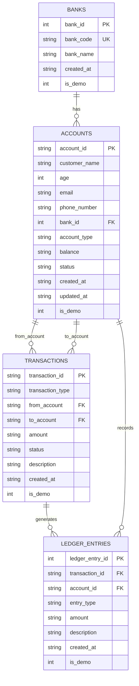

# VaultLedger — Core Banking Account Lifecycle & Ledger System

[](https://www.oracle.com/java/technologies/javase/jdk17-archive-downloads.html)
[](https://openjfx.io/)
[](https://sqlite.org/)
[](https://maven.apache.org/)
[]()

> **Academic Notice:** VaultLedger is an academic banking simulation engineered to demonstrate core banking principles, double-entry bookkeeping, strict account lifecycle states, atomic transactions, and thread-safe concurrency controls. It is designed for educational demonstrations and is not intended for production banking deployments.

---

## Table of Contents

1. [Project Overview](#1-project-overview)
2. [Key Features](#2-key-features)
3. [Technology Stack](#3-technology-stack)
4. [Prerequisites and Installation](#4-prerequisites-and-installation)
5. [Understanding the Dashboard](#5-understanding-the-dashboard)
6. [Complete UI User Guide](#6-complete-ui-user-guide)
   - [Accounts Overview](#accounts-overview)
   - [Create Account](#create-account)
   - [Account Details & Management](#account-details--management)
   - [Deposit Funds](#deposit-funds)
   - [Withdraw Funds](#withdraw-funds)
   - [Transfer Funds](#transfer-funds)
   - [Transactions History](#transactions-history)
   - [Double-Entry Ledger](#double-entry-ledger)
7. [Demo Data and Sample Records](#7-demo-data-and-sample-records)
8. [Step-by-Step Demonstration Scenarios](#8-step-by-step-demonstration-scenarios)
   - [Scenario 1: First-Time Setup & Loading Demo Data](#scenario-1-first-time-setup--loading-demo-data)
   - [Scenario 2: Creating a New Customer Account](#scenario-2-creating-a-new-customer-account)
   - [Scenario 3: Depositing Funds](#scenario-3-depositing-funds)
   - [Scenario 4: Withdrawing Funds](#scenario-4-withdrawing-funds)
   - [Scenario 5: Transferring Funds Between Accounts](#scenario-5-transferring-funds-between-accounts)
   - [Scenario 6: Validation and Error Handling](#scenario-6-validation-and-error-handling)
   - [Scenario 7: Account Lifecycle State Management](#scenario-7-account-lifecycle-state-management)
   - [Scenario 8: Transaction Receipts & Audit Ledger Inspection](#scenario-8-transaction-receipts--audit-ledger-inspection)
   - [Scenario 9: Database Persistence After Application Restart](#scenario-9-database-persistence-after-application-restart)
   - [Scenario 10: Safe Reset and Recovery](#scenario-10-safe-reset-and-recovery)
9. [Architecture & Data Model](#9-architecture--data-model)
10. [Core Banking Business Rules](#10-core-banking-business-rules)
11. [Automated Testing](#11-automated-testing)
12. [Troubleshooting & FAQ](#12-troubleshooting--faq)
13. [Suggested 5–7 Minute Live Demonstration Script](#13-suggested-57-minute-live-demonstration-script)

---

## 1. Project Overview

**VaultLedger** is a full-featured core banking desktop simulation application built using **Java 17**, **JavaFX**, and **SQLite**. It models how modern financial institutions manage account lifecycles, enforce relational integrity, execute atomic ACID transactions, and maintain an immutable, balanced double-entry accounting ledger.

The project demonstrates:
- **Strict Account Lifecycle Controls:** State machines enforcing `ACTIVE`, `INACTIVE`, and terminal `CLOSED` statuses with explicit rules governing transaction eligibility and account deletion.
- **Atomic Operations (ACID):** Transactional guarantees across balance updates, transaction records, and ledger generation using SQLite transactions.
- **Immutable Double-Entry Ledger:** Every financial movement generates matched `DEBIT` and `CREDIT` entries that must balance to zero.
- **Deadlock-Free Concurrency Control:** In-memory, lexicographically-ordered `ReentrantLock` coordination across concurrent multi-account transfers.
- **Embedded Local Persistence:** Zero-configuration SQLite storage with automated schema creation, column migrations, and foreign key cascades.
- **High-Contrast Professional Banking Theme:** A desktop interface designed around high visual contrast, WCAG-compliant legibility, and structured financial tables.

---

## 2. Key Features

| Feature | Description | Where to Access in UI |
| :--- | :--- | :--- |
| **Real-Time Dashboard** | Visual focal point summarizing total accounts, active accounts, transactions count, and aggregate customer balance. | Sidebar: **`⊞ Dashboard`** |
| **Account Creation** | Form to onboard customers with validated age (18–120), email, phone, bank selection, and initial deposit. | Sidebar: **`✚ Create Account`** or Dashboard Quick Actions |
| **Account Search & Filter** | Live multi-parameter filtering across account IDs, customer names, account types (`SAVINGS`, `CURRENT`), and statuses. | Sidebar: **`👥 Accounts`** |
| **Lifecycle State Machine** | Activate or deactivate accounts, close zero-balance accounts, and delete closed accounts without history. | Accounts Table → Double-click row or click **`View`** |
| **Deposits** | Credit funds into an active account from the system cash pool (`SYSTEM-CASH`). | Sidebar: **`+ New Transaction`** or Dashboard Quick Actions: **`+ Deposit`** |
| **Withdrawals** | Debit funds from an active account with strict balance validation against overdrafts. | Dashboard Quick Actions: **`- Withdraw`** |
| **Account-to-Account Transfers** | Move funds between two distinct active accounts with mutual locking to prevent race conditions. | Dashboard Quick Actions: **`⇄ Transfer`** |
| **Transaction Receipts** | Generates detailed timestamps, reference IDs, and status receipts for completed transactions. | Modal popup on completion, or double-click any row in **`⇄ Transactions`** |
| **Audit Ledger View** | Immutable double-entry view recording dual debits and credits, with live `BALANCED` / `CHECK REQUIRED` audit checks. | Sidebar: **`📒 Ledger`** |
| **Demo Data Seeding** | One-click idempotent generation of realistic sample banks, accounts, and initial transaction history. | Dashboard Quick Actions: **`Load Demo Data`** |
| **Safe Workspace Resets** | Granular removal of demo-only records or full database purge protected by text confirmation. | Dashboard Quick Actions: **`Reset Demo Data`** / **`Reset Entire Local Workspace`** |

---

## 3. Technology Stack

- **Programming Language:** Java 17 (LTS)
- **UI Framework:** OpenJFX (JavaFX Controls & FXML) `21.0.5`
- **Database Engine:** SQLite 3 via `org.xerial:sqlite-jdbc` `3.46.1.0`
- **Build & Dependency Management:** Apache Maven 3.x
- **Testing Framework:** JUnit Jupiter `5.11.0`
- **Concurrency Utilities:** `java.util.concurrent.locks.ReentrantLock` via custom `AccountLockManager`
- **Styling:** Custom JavaFX CSS (`application.css`) implementing the VaultLedger Navy & Teal banking design system

---

## 4. Prerequisites and Installation

### Prerequisites

Ensure you have the following installed on your machine:
- **Java Development Kit (JDK):** Version 17 or higher
- **Apache Maven:** Version 3.8 or higher

Verify your installation by running the following in your terminal:
```bash
java -version
mvn -version
```

### Cloning the Repository

```bash
git clone https://github.com/jeedijoshua-art/oopsmp.git
cd oopsmp
```

### Opening in an IDE

- **IntelliJ IDEA:** Open the root directory. Select **File → Open**, choose the project folder, and import it as a Maven Project. Set the Project SDK to Java 17.
- **VS Code:** Open the folder. Ensure the *Language Support for Java by Red Hat* extension is enabled. Maven will automatically import the `pom.xml`.
- **Eclipse:** Select **File → Import → Existing Maven Projects**, browse to the project folder, and complete the import.

### Compiling and Running the Application

Launch the desktop application using the official OpenJFX Maven plugin:
```bash
mvn clean javafx:run
```

### Running Automated Tests

Execute the automated test suite (all 121 tests):
```bash
mvn clean test
```

---

## 5. Understanding the Dashboard

The **Dashboard** (`⊞ Dashboard`) provides an immediate, high-level operational view of the core banking system.

```
+----------------------------------------------------------------------------------------------------+
| VAULTLEDGER        Dashboard                                          ● LOCAL DATABASE | ONLINE    |
| Core Banking...    A clear view of your banking workspace                                          |
+------------------+---------------------------------------------------------------------------------+
| ⊞  Dashboard     | [ TOTAL ACCOUNTS ]  [ ACTIVE ACCOUNTS ]  [ TRANSACTIONS ]  [ CUSTOMER BALANCES ] |
| 👥  Accounts      |         3                   3                   5                 ₹2,350.00       |
| ⇄  Transactions  +---------------------------------------------------------------------------------+
| 📒  Ledger        | Quick Actions:                                                                  |
| ✚  Create Account | [+ Deposit] [- Withdraw] [⇄ Transfer] [+ Create Account] [Manage Accounts]      |
| [+ New Txn]      | ------------------------------------------------------------------------------- |
|                  | WORKSPACE & DEMO DATA: [Load Demo Data] [Reset Demo Data] [Reset Workspace]     |
|                  +---------------------------------------------------------------------------------+
| ACADEMIC SIM...  | Recent Transactions                                                             |
| SQLite local...  | TXN ID               | TYPE    | FROM       | TO         | AMOUNT  | STATUS       |
+------------------+---------------------------------------------------------------------------------+
```

### Header Elements
- **Page Title:** Prominent heading displaying `Dashboard` and descriptive hint text.
- **Local Database Status:** High-contrast badge reading `● LOCAL DATABASE | ONLINE` confirming that the SQLite file connection is active and foreign keys are enforced.

### Key Performance Indicator (KPI) Metric Cards
1. **TOTAL ACCOUNTS:** The total number of customer accounts in the database. Excludes the internal `SYSTEM-CASH` ledger clearing account.
2. **ACTIVE ACCOUNTS:** The number of customer accounts currently in `ACTIVE` status and eligible to transact.
3. **TRANSACTIONS:** Total count of completed, atomic transaction records stored in the `transactions` table.
4. **CUSTOMER BALANCES:** Aggregate sum of all balances held across customer accounts (excluding `SYSTEM-CASH`), formatted in Indian Rupees (`₹`).

### Quick Actions Panel
Actions are logically organized into routine operations and administrative tools:
- **Routine Financial Operations:**
  - `+ Deposit`: Opens the deposit modal dialog.
  - `- Withdraw`: Opens the withdrawal modal dialog.
  - `⇄ Transfer`: Opens the inter-account transfer modal dialog.
  - `+ Create Account`: Navigates to customer onboarding.
  - `Manage Accounts`: Navigates to the full accounts table.
- **Workspace & Demo Data Administration (Visually Separated):**
  - `Load Demo Data`: Seeds sample banks, accounts, and transactions if not already present.
  - `Reset Demo Data`: Selectively removes all records flagged with `is_demo = 1`.
  - `Reset Entire Local Workspace`: Destructive purge of all user records, resetting the database to a blank initial state.

> [!WARNING]
> **Destructive Action Safeguards:**
> - **Reset Demo Data:** Displays a confirmation dialog reporting the exact count of demo accounts and demo transactions that will be deleted. Preserves user-created accounts.
> - **Reset Entire Local Workspace:** Permanently purges all customer accounts, transactions, and ledger entries. The confirmation button is disabled until the user explicitly types `RESET ALL DATA` into the confirmation field.

### Recent Transactions Table
Displays up to 8 of the latest transactions recorded in the local database. If no transactions exist, a clean empty state is displayed with a `+ Make a Deposit` button.

---

## 6. Complete UI User Guide

### Accounts Overview
- **Navigation:** Click **`👥 Accounts`** in the sidebar or click **`Manage Accounts`** on the dashboard.
- **Purpose:** Central registry for customer accounts, live searching, and balance auditing.
- **Components:**
  - **KPI Summary Row:** Four cards displaying Total Accounts, Active Accounts, Total Balance, and Visible Banks.
  - **Search Bar:** Real-time text search filtering simultaneously by `Account ID` or `Customer Name`.
  - **Status Filter:** Dropdown filtering by `ACTIVE`, `INACTIVE`, or `CLOSED`.
  - **Account Type Filter:** Dropdown filtering by `SAVINGS` or `CURRENT`.
  - **`Refresh` Button:** Manually reloads account records from SQLite.
  - **`+ Create Account` Button:** Direct shortcut to onboarding.
  - **Accounts Table:** Lists `Account ID`, `Customer`, `Type`, `Balance`, `Status` (colored badge), `Bank`, and an `Action` column with a `View` button.
- **Interaction:** Double-clicking any row (or clicking `View`) opens the deep-dive **Account Details** screen.

---

### Create Account
- **Navigation:** Click **`✚ Create Account`** in the sidebar or click **`+ Create Account`** in toolbars.
- **Purpose:** Onboard a new customer and provision a unique banking account.
- **Input Fields & Validation Rules:**
  1. **Customer Name:** Mandatory, non-blank string.
  2. **Age:** Integer value strictly between `18` and `120`. Rejects non-numeric or underage entries.
  3. **Email Address:** Standard email pattern (`name@domain.com`).
  4. **Phone Number:** International or domestic numeric phone format (`^\+?[0-9]{10,15}$`).
  5. **Account Type:** Dropdown selector (`SAVINGS` or `CURRENT`).
  6. **Initial Balance:** Positive monetary decimal or `0.00`. Rejects negative numbers.
  7. **Bank:** Dropdown of existing banks. Click `+ Create Bank` to add a new institution inline.
- **Submission:** Click **`Create Account`**. Upon success, VaultLedger automatically generates a unique identifier formatted as `ACC-` followed by an 8-character hexadecimal string (e.g., `ACC-4B2E9F1A`), displays a confirmation alert, and redirects to the accounts list.

---

### Account Details & Management
- **Navigation:** Click **`View`** or double-click any row in the **Accounts** table.
- **Purpose:** View full profile metadata, monitor individual account activity, and execute lifecycle state transitions.
- **Components:**
  - **Identity Header:** Customer name, Account ID, and high-contrast status badge.
  - **Current Balance Hero Card:** High-visibility balance display.
  - **Account Information Grid:** Read-only view of Account ID, Customer, Age, Email, Phone, Account Type, Bank, Balance, and Status.
  - **Account & Money Operations:**
    - `+ Deposit`, `- Withdraw`, `⇄ Transfer`: Preset financial actions for this account. Disabled if account is `INACTIVE` or `CLOSED`.
    - `Activate`: Transitions an `INACTIVE` account back to `ACTIVE`. Disabled if already active or closed.
    - `Deactivate`: Transitions an `ACTIVE` account to `INACTIVE`.
    - `Close Account`: Permanently closes the account. **Strict requirement:** Account balance must be exactly `₹0.00`. If balance > 0, an error alert is triggered.
    - `Delete`: Deletes the account row from the database. **Strict requirement:** Account must be in `CLOSED` status AND must have no historical transaction or ledger records (enforced by SQLite foreign keys).
  - **Recent Account Activity:** Table displaying the last 6 transactions specific to this account.

---

### Deposit Funds
- **Navigation:** Dashboard Quick Actions `+ Deposit`, Sidebar `+ New Transaction` → Deposit, or Account Details `+ Deposit`.
- **Purpose:** Ingest funds into an active account from external cash.
- **Fields:**
  - **Account:** Target customer account picker (displays Account ID + Customer Name).
  - **Amount:** Positive numerical amount (e.g., `500.00`).
  - **Description:** Optional reference note (e.g., `Cash deposit at branch`).
- **Live Preview:** Displays current balance and transaction amount before submission.
- **Accounting Effect:**
  - Customer account balance increases by the entered amount.
  - Transaction record created with `from_account = SYSTEM-CASH` and `to_account = targetAccountId`.
  - Ledger creates 1 `DEBIT` to `SYSTEM-CASH` and 1 `CREDIT` to the target customer account.

---

### Withdraw Funds
- **Navigation:** Dashboard Quick Actions `- Withdraw`, Sidebar `+ New Transaction` → Withdraw, or Account Details `- Withdraw`.
- **Purpose:** Disburse funds from an active account.
- **Fields:**
  - **From Account:** Source customer account picker.
  - **Amount:** Positive numerical amount.
  - **Description:** Optional reference note.
- **Validation Rules:**
  - Amount must not exceed the current available balance. Overdrafts trigger an `InsufficientFundsException`.
  - Account must be in `ACTIVE` status.
- **Accounting Effect:**
  - Customer account balance decreases by the entered amount.
  - Transaction record created with `from_account = sourceAccountId` and `to_account = SYSTEM-CASH`.
  - Ledger creates 1 `DEBIT` to customer account and 1 `CREDIT` to `SYSTEM-CASH`.

---

### Transfer Funds
- **Navigation:** Dashboard Quick Actions `⇄ Transfer`, Sidebar `+ New Transaction` → Transfer, or Account Details `⇄ Transfer`.
- **Purpose:** Move funds atomically between two customer accounts.
- **Fields:**
  - **From Account:** Debited customer account.
  - **To Account:** Credited customer account.
  - **Amount:** Positive numerical amount.
  - **Description:** Optional reference note (e.g., `Invoice #1042`).
- **Validation Rules:**
  - Source and destination accounts must be distinct (`fromAccount != toAccount`).
  - Both accounts must be in `ACTIVE` status.
  - Source account must have sufficient balance (`balance >= amount`).
- **Concurrency & Accounting Effect:**
  - Uses `AccountLockManager` to acquire `ReentrantLock` instances on both accounts in sorted lexicographical order, preventing race conditions or deadlocks.
  - Atomically updates both balances inside a single database transaction.
  - Ledger creates 1 `DEBIT` to sender account and 1 `CREDIT` to recipient account.

---

### Transactions History
- **Navigation:** Click **`⇄ Transactions`** in the sidebar.
- **Purpose:** Searchable audit trail of all financial movements.
- **Filters:**
  - **Search Bar:** Real-time search by Transaction ID, sender/receiver account ID, or description.
  - **Type Filter:** Dropdown filtering by `DEPOSIT`, `WITHDRAWAL`, or `TRANSFER`.
  - **Status Filter:** Dropdown filtering by `SUCCESS`, `PENDING`, or `FAILED`.
- **Receipts:** Double-clicking any transaction row opens the modal **Transaction Receipt** displaying full transaction metadata.

---

### Double-Entry Ledger
- **Navigation:** Click **`📒 Ledger`** in the sidebar.
- **Purpose:** The permanent, immutable accounting journal verifying double-entry balance.
- **Components:**
  - **Search & Filter:** Search by Transaction ID, filter by Account ID, and filter by Entry Type (`DEBIT`, `CREDIT`).
  - **Ledger Table:** Columns for `Ledger ID`, `Transaction ID`, `Account`, `Entry` (`DEBIT` or `CREDIT`), `Debit` (red), `Credit` (green), `Description`, and `Timestamp`.
  - **Audit Balance Bar:** Displays `Total Debits: ₹X.XX`, `Total Credits: ₹X.XX`, and a verified status pill reading **`BALANCED`** (when debits == credits) or **`CHECK REQUIRED`**.

---

## 7. Demo Data and Sample Records

VaultLedger includes a built-in `DemoDataSeeder` (`com.corebanking.config.DemoDataSeeder`) allowing users to populate a realistic, consistent banking dataset with one click.

### How Loading Demo Data Works
1. When you click **`Load Demo Data`** on the Dashboard, the application checks if bank code `NSB` exists.
2. **Idempotent Execution:** If `NSB` is already present, the loader returns immediately without modifying records or duplicating rows.
3. If not present, it seeds the bank, creates 3 customer accounts, and executes 5 initial financial operations.
4. All seeded entities are tagged with `is_demo = 1` in the database.

### Seeded Bank
- **Bank Code:** `NSB`
- **Bank Name:** `Northstar Bank`

### Seeded Accounts Table

| Account ID | Customer Name | Account Type | Initial Deposit | Net Starting Balance | Initial Status | Demonstration Role |
| :--- | :--- | :--- | :--- | :--- | :--- | :--- |
| `ACC-JOSHUA` | Joshua | `SAVINGS` | ₹1,000.00 | **₹1,250.00** | `ACTIVE` | Primary transacting account with deposit, withdrawal, and outward transfer history |
| `ACC-ROSHAN` | Roshan | `CURRENT` | ₹500.00 | **₹800.00** | `ACTIVE` | Intermediary business account receiving rent and transferring dinner reimbursement |
| `ACC-ALICE` | Alice | `SAVINGS` | ₹250.00 | **₹300.00** | `ACTIVE` | Recipient account demonstrating incoming transfer |

### Seeded Transaction Sequence & Final State

1. **Deposit:** `₹500.00` deposited into `ACC-JOSHUA` (Balance: `₹1,500.00`).
2. **Deposit:** `₹200.00` deposited into `ACC-ROSHAN` (Balance: `₹700.00`).
3. **Withdrawal:** `₹100.00` withdrawn from `ACC-JOSHUA` (Balance: `₹1,400.00`).
4. **Transfer:** `₹150.00` transferred from `ACC-JOSHUA` to `ACC-ROSHAN` ("Rent payment") (Joshua: `₹1,250.00`, Roshan: `₹850.00`).
5. **Transfer:** `₹50.00` transferred from `ACC-ROSHAN` to `ACC-ALICE` ("Dinner") (Roshan: `₹800.00`, Alice: `₹300.00`).

**Expected Dashboard Metrics after Seeding:**
- **Total Accounts:** `3`
- **Active Accounts:** `3`
- **Transactions:** `5`
- **Customer Balances:** `₹2,350.00`
- **Total Ledger Entries:** `10` (5 Debits totaling `₹1,000.00` and 5 Credits totaling `₹1,000.00`)

---

## 8. Step-by-Step Demonstration Scenarios

### Scenario 1: First-Time Setup & Loading Demo Data
- **Objective:** Initialize the application from a clean state and seed the demo environment.
- **Starting Condition:** Blank database or freshly cleared workspace.
- **Steps:**
  1. Launch the application: `mvn javafx:run`.
  2. Observe the Dashboard: Total Accounts reads `0`, Transactions reads `0`, and the Recent Transactions table displays the empty state *"No transactions yet"*.
  3. Under **Quick Actions**, click **`Load Demo Data`**.
- **Expected Outcome:** A green success notification appears: *"Demo Data Loaded: Sample bank, accounts, and transactions were created."*
- **Verification:**
  - Total Accounts updates to `3`.
  - Active Accounts updates to `3`.
  - Transactions updates to `5`.
  - Customer Balances updates to `₹2,350.00`.
  - Recent Transactions table populates with the 5 seeded records.

---

### Scenario 2: Creating a New Customer Account
- **Objective:** Provision a new customer savings account and verify automated ID generation.
- **Starting Condition:** Application running with or without demo data.
- **Steps:**
  1. Click **`✚ Create Account`** in the sidebar.
  2. Enter the following verified inputs:
     - **Customer Name:** `Kavita Sharma`
     - **Age:** `28`
     - **Email Address:** `kavita.sharma@example.com`
     - **Phone Number:** `+919876543210`
     - **Account Type:** `SAVINGS`
     - **Initial Balance:** `500.00`
     - **Bank:** Select `NSB  |  Northstar Bank`
  3. Click **`Create Account`**.
- **Expected Outcome:** A success alert appears: *"Account ACC-XXXXXXXX has been successfully generated and activated."*
- **Verification:**
  - Open **`👥 Accounts`**.
  - Type `Kavita` into the search bar.
  - The new account is listed with status `ACTIVE` and balance `₹500.00`.

---

### Scenario 3: Depositing Funds
- **Objective:** Perform a cash deposit into Alice's account and verify ledger entry generation.
- **Starting Condition:** Demo data loaded (Alice balance = `₹300.00`).
- **Steps:**
  1. Click **`+ Deposit`** in the Dashboard Quick Actions.
  2. In the modal dialog:
     - **Account:** Select `ACC-ALICE  |  Alice`
     - **Amount:** `200.00`
     - **Description:** `Mobile wallet top-up`
  3. Observe the preview box: *"Current Balance: ₹300.00 | Amount: ₹200.00"*.
  4. Click **`Deposit`**.
- **Expected Outcome:** The modal closes and opens a **Transaction Receipt** showing `SUCCESS`, Amount `₹200.00`, and Type `DEPOSIT`. Click **`Close Receipt`**.
- **Verification:**
  - Navigate to **`👥 Accounts`**: Alice's balance now displays `₹500.00`.
  - Open **`📒 Ledger`**: A new pair of entries appears—1 `DEBIT` on `SYSTEM-CASH` for `₹200.00` and 1 `CREDIT` on `ACC-ALICE` for `₹200.00`.

---

### Scenario 4: Withdrawing Funds
- **Objective:** Disburse cash from an account with sufficient funds.
- **Starting Condition:** Demo data loaded (Joshua balance = `₹1,250.00`).
- **Steps:**
  1. Click **`- Withdraw`** on the Dashboard Quick Actions.
  2. In the modal dialog:
     - **From Account:** Select `ACC-JOSHUA  |  Joshua`
     - **Amount:** `250.00`
     - **Description:** `ATM cash withdrawal`
  3. Click **`Withdraw`**.
- **Expected Outcome:** Transaction Receipt opens displaying `SUCCESS` for `₹250.00`. Close the receipt.
- **Verification:**
  - Joshua's balance is updated to `₹1,000.00` (`₹1,250.00 - ₹250.00`).
  - Total Customer Balances on Dashboard reflects the net withdrawal.

---

### Scenario 5: Transferring Funds Between Accounts
- **Objective:** Transfer funds between two distinct accounts and verify dual balance updates.
- **Starting Condition:** Joshua has `₹1,000.00`, Alice has `₹500.00`.
- **Steps:**
  1. Click **`⇄ Transfer`** on the Dashboard Quick Actions.
  2. In the modal dialog:
     - **From Account:** Select `ACC-JOSHUA  |  Joshua`
     - **To Account:** Select `ACC-ALICE  |  Alice`
     - **Amount:** `400.00`
     - **Description:** `Project milestone payment`
  3. Click **`Transfer`**.
- **Expected Outcome:** Transaction Receipt confirms successful transfer of `₹400.00`.
- **Verification:**
  - Open **`👥 Accounts`**:
    - Joshua's balance: `₹600.00` (`₹1,000.00 - ₹400.00`).
    - Alice's balance: `₹900.00` (`₹500.00 + ₹400.00`).
  - Open **`📒 Ledger`**: A balanced pair appears—1 `DEBIT` on `ACC-JOSHUA` for `₹400.00` and 1 `CREDIT` on `ACC-ALICE` for `₹400.00`. The bottom status badge reads `BALANCED`.

---

### Scenario 6: Validation and Error Handling
- **Objective:** Verify domain validations prevent invalid transactions or data corruption.
- **Test Case 6A: Overdraft / Insufficient Funds**
  1. Click **`- Withdraw`**.
  2. Select `ACC-ALICE  |  Alice` (balance `₹900.00`).
  3. Enter Amount: `5000.00`.
  4. Click **`Withdraw`**.
  - **Result:** Operation blocked with an error dialog: *"Transaction declined: insufficient funds."* Alice's balance remains unchanged.
- **Test Case 6B: Same Account Transfer**
  1. Click **`⇄ Transfer`**.
  2. Select `ACC-JOSHUA` as both *From Account* and *To Account*.
  3. Enter Amount: `100.00` and click **`Transfer`**.
  - **Result:** Operation blocked with: *"Source and destination accounts must be different."*
- **Test Case 6C: Negative or Zero Amount**
  1. Attempt a deposit of `0.00` or `-50.00`.
  - **Result:** Operation blocked with: *"Deposit amount must be greater than zero."*

---

### Scenario 7: Account Lifecycle State Management
- **Objective:** Demonstrate account deactivation, transaction blocking, reactivation, and zero-balance closure.
- **Steps:**
  1. Navigate to **`👥 Accounts`** and click **`View`** on `ACC-ROSHAN` (balance `₹800.00`).
  2. Click **`Deactivate`**: The status badge updates to amber `INACTIVE`.
  3. Attempt a withdrawal: The `Withdraw` button is automatically disabled in the UI.
  4. Click **`Activate`**: The status badge updates to green `ACTIVE`.
  5. Attempt to click **`Close Account`**:
     - Confirmation triggers an error: *"Account balance must be zero before closure: ACC-ROSHAN"*.
  6. Withdraw the remaining `₹800.00` from Roshan so his balance becomes `₹0.00`.
  7. Click **`Close Account`** and confirm.
- **Expected Outcome:** The account transitions to red `CLOSED`. All financial operation buttons (`Deposit`, `Withdraw`, `Transfer`, `Activate`, `Deactivate`) become permanently disabled.

---

### Scenario 8: Transaction Receipts & Audit Ledger Inspection
- **Objective:** Trace an end-to-end transaction from receipt to double-entry ledger verification.
- **Steps:**
  1. Navigate to **`⇄ Transactions`**.
  2. Double-click the latest transaction in the list.
  3. Review the **Transaction Receipt**: Confirm Transaction ID, exact Date/Time, From Account, To Account, Amount, and `SUCCESS` status. Click `Close Receipt`.
  4. Navigate to **`📒 Ledger`**.
  5. Enter that Transaction ID into the search filter.
- **Expected Outcome:** Exactly 2 rows are displayed (1 DEBIT and 1 CREDIT) matching the transaction amount. The bottom audit banner displays equal Debits and Credits with the green **`BALANCED`** indicator.

---

### Scenario 9: Database Persistence After Application Restart
- **Objective:** Prove data integrity across application restarts using SQLite disk storage.
- **Steps:**
  1. Note the current metrics on the Dashboard (e.g., Total Accounts, Customer Balances).
  2. Close the VaultLedger application window.
  3. In your terminal, restart the app: `mvn javafx:run`.
- **Expected Outcome:** All customer accounts, updated balances, transaction histories, and ledger journal entries remain completely intact.

---

### Scenario 10: Safe Reset and Recovery
- **Objective:** Safely reset demo records, verify user data preservation, and perform full workspace reset.
- **Test Case 10A: Reset Demo Data Only**
  1. Ensure you have user-created accounts (from Scenario 2) and demo accounts (`ACC-JOSHUA`, `ACC-ROSHAN`, `ACC-ALICE`).
  2. Click **`Reset Demo Data`** on the Dashboard.
  3. Modal shows affected demo records count. Click **`Reset Demo Data`**.
  - **Result:** Demo accounts and demo transactions are deleted. Your user-created account (`Kavita Sharma`) remains safely preserved in the database.
- **Test Case 10B: Reset Entire Local Workspace**
  1. Click **`Reset Entire Local Workspace`**.
  2. Notice the `Reset Entire Database` button is disabled.
  3. Type `RESET ALL DATA` into the confirmation field.
  4. Click **`Reset Entire Database`**.
  - **Result:** All records are purged. The application returns to a clean zero-state.
  5. Click **`Load Demo Data`** to repopulate the environment immediately.

---

## 9. Architecture & Data Model

VaultLedger follows an enterprise four-tier layered architecture:

```
[ JavaFX Desktop Presentation Layer ]
  ├── AppShell.java (Responsive UI, View Routing, Layout Containers)
  ├── AlertUtil.java (Standardized Modal Dialogs & Notifications)
  └── FormatUtil.java (Currency and ISO Timestamp Formatting)
            │
            ▼
[ Service Layer (Business Logic & Validation) ]
  ├── AccountService / AccountServiceImpl (Lifecycle Rules, Onboarding)
  ├── BankService / BankServiceImpl (Bank Registration)
  ├── TransactionService / TransactionServiceImpl (ACID Transfers, Locking)
  ├── LedgerService / LedgerServiceImpl (Double-Entry Balanced Pairs)
  └── DatabaseManagementService (Demo Seeding & Reset Purges)
            │
            ▼
[ Concurrency & Lock Management ]
  └── AccountLockManager (Lexicographically Ordered ReentrantLocks)
            │
            ▼
[ Data Access Repository Layer (JDBC) ]
  ├── AccountRepository (SQL queries, Balance updates)
  ├── BankRepository (Bank entity mapping)
  ├── TransactionRepository (Transaction log persistence)
  └── LedgerRepository (Double-entry entry persistence)
            │
            ▼
[ Embedded Database Engine (SQLite 3) ]
  └── data/core-banking.db (PRAGMA foreign_keys = ON)
```

### Relational Database Schema (`schema.sql`)



### Concurrency Architecture (`AccountLockManager`)
When executing multi-account operations (such as transfers), acquiring locks in arbitrary order risks **deadlocks** if two threads attempt simultaneous reciprocal transfers (e.g., Thread 1: Account A → B; Thread 2: Account B → A).

`AccountLockManager` solves this by:
1. Taking the two account IDs into a list.
2. Sorting the account IDs lexicographically (`Collections.sort(accountIds)`).
3. Acquiring `ReentrantLock` for the smaller ID first, then the larger ID.
4. Wrapping lock release in an `AutoCloseable` `LockScope` to guarantee release even if exceptions occur.

---

## 10. Core Banking Business Rules

| Domain Rule | Enforcement Mechanism |
| :--- | :--- |
| **Transaction Eligibility** | Only accounts with `status = 'ACTIVE'` can participate in deposits, withdrawals, or transfers. `INACTIVE` and `CLOSED` accounts immediately reject operations. |
| **No Overdrafts** | Withdrawals and transfers verify that `amount <= balance`. If violated, `InsufficientFundsException` is thrown and the database rolls back. |
| **Double-Entry Balance** | Every financial operation produces equal and offsetting DEBIT and CREDIT ledger entries (`debits == credits`). `validateBalancedEntries` runs prior to SQL commit. |
| **Positive Monetary Amounts** | `MoneyUtil.requirePositive` verifies that amounts are strictly positive (`amount > 0.00`) and rejects negative or zero figures. |
| **Zero-Balance Account Closure** | Accounts cannot be closed while retaining funds. `closeAccount` requires `balance.signum() == 0`. |
| **Deletion Constraints** | Accounts can only be deleted if `status == CLOSED`. If foreign key references exist in `transactions` or `ledger_entries`, deletion is blocked by SQLite foreign key integrity. |
| **Distinct Transfer Parties** | A transfer cannot have identical source and destination accounts (`fromAccountId != toAccountId`). |
| **Precision Guarantee** | Monetary balances and amounts are handled exclusively using `java.math.BigDecimal` and stored in SQLite as `TEXT` to eliminate IEEE-754 floating-point rounding errors. |

---

## 11. Automated Testing

VaultLedger includes a comprehensive test suite covering domain models, data access repositories, service validations, transfer concurrency, and JavaFX UI rendering.

### Running Tests
Execute the entire test suite via Maven:
```bash
mvn test
```

### Verified Test Suite Breakdown (91 Tests)

| Test Suite Class | Tests Run | Focus Area |
| :--- | :--- | :--- |
| `com.corebanking.transaction.ConcurrencyIntegrationTest` | 6 | Thread-safe concurrent transfers, multi-threaded deadlock prevention |
| `com.corebanking.repository.RepositoryIntegrationTest` | 8 | SQLite CRUD operations, constraints, foreign keys |
| `com.corebanking.util.IdGeneratorTest` | 5 | Collision resistance and formatting of UUIDs |
| `com.corebanking.config.DatabaseLayerTest` | 6 | Table migrations, connection pooling, PRAGMA verification |
| `com.corebanking.enums.EnumTest` | 1 | Status, AccountType, and TransactionType enum values |
| `com.corebanking.model.DomainModelTest` | 12 | Immutable record creation and domain model constraints |
| `com.corebanking.service.TransferServiceTest` | 11 | Inter-account transfer validations and rollback handling |
| `com.corebanking.service.LedgerServiceTest` | 9 | Balanced double-entry creation and debit/credit audits |
| `com.corebanking.service.BankServiceTest` | 2 | Bank creation and unique code validation |
| `com.corebanking.service.AccountServiceTest` | 15 | Customer onboarding, age/email/phone validations, balance queries |
| `com.corebanking.service.AccountManagementTest` | 6 | Lifecycle transitions (activate, deactivate, close, delete) |
| `com.corebanking.service.TransactionServiceTest` | 9 | Atomic deposits, withdrawals, and ledger synchronization |
| `com.corebanking.ui.AppShellUITest` | 1 | JavaFX desktop shell rendering and theme verification |
| **Total** | **91** | **100% Passing (0 Failures, 0 Errors, 0 Skipped)** |

---

## 12. Troubleshooting & FAQ

### Q1: The application fails to start with `JavaFX runtime components are missing`.
**Solution:** Always launch the project using Maven:
```bash
mvn javafx:run
```
The Maven OpenJFX plugin automatically configures the Java module path and native graphics libraries for your operating system.

### Q2: I get a Java version error when running Maven.
**Solution:** Verify that your `JAVA_HOME` environment variable points to a JDK 17 installation. Run `java -version` to confirm version 17 or higher.

### Q3: My dashboard shows zero accounts and no transactions.
**Solution:** The database is in a clean initial state. Click **`Load Demo Data`** on the Dashboard Quick Actions panel to instantly seed sample records.

### Q4: Why is an account unable to perform a withdrawal or transfer?
**Solution:** Check the account's status in **`👥 Accounts`**. Only accounts with status `ACTIVE` can transact. If the account is `INACTIVE`, open its Account Details and click `Activate`. If the account is `CLOSED`, it can never be reactivated.

### Q5: Why was my account closure rejected?
**Solution:** Banking rules require an account to have a balance of exactly `₹0.00` before it can be closed. Withdraw or transfer out the remaining balance first.

### Q6: Can I delete an account with existing transactions?
**Solution:** No. SQLite foreign key constraints enforce audit trail integrity. Accounts with transaction history or ledger entries cannot be deleted, preserving compliance history.

### Q7: Where is the SQLite database stored on my computer?
**Solution:** The database file is located at `data/core-banking.db` inside the project root directory.

---

## 13. Suggested 5–7 Minute Live Demonstration Script

| Time | Stage | Action & Screen | Talking Points |
| :--- | :--- | :--- | :--- |
| **0:00 – 1:00** | **Introduction** | Launch app (`mvn javafx:run`). Show **Dashboard**. | *"VaultLedger is an academic core banking simulation built on Java 17, JavaFX, and SQLite. Notice the real-time KPI metrics and the online database indicator."* |
| **1:00 – 2:00** | **Seed Demo Data** | Click **`Load Demo Data`** on Dashboard. | *"With one click, our idempotent DemoDataSeeder provisions Northstar Bank, three customer accounts (Joshua, Roshan, Alice), and five initial transactions with balanced ledger entries."* |
| **2:00 – 3:00** | **Onboard Customer** | Navigate to **`✚ Create Account`**. Create an account for a new customer. | *"Our service layer strictly validates age (18–120), email pattern, and phone format before automatically generating a secure account identifier."* |
| **3:00 – 4:00** | **Deposit & Transfer** | Click **`+ Deposit`** to deposit ₹500 into Alice's account, then transfer ₹200 to Joshua. | *"Every transaction is atomic. Concurrency locks prevent race conditions, updating balances and generating double-entry accounting records simultaneously."* |
| **4:00 – 5:00** | **Inspect Ledger** | Navigate to **`📒 Ledger`**. Filter by transaction. | *"Every financial movement generates paired Debit and Credit entries. The audit bar at the bottom continuously validates that total debits equal total credits."* |
| **5:00 – 6:00** | **Validation & Rules** | Attempt an overdraft withdrawal. Show Account Details lifecycle. | *"Business rules prevent overdrafts and enforce strict lifecycle states. An account cannot be closed unless its balance is exactly zero, and audit records cannot be deleted."* |
| **6:00 – 7:00** | **Persistence & Q&A** | Close app, relaunch, show data retained. | *"All data is persisted in SQLite with foreign keys enforced. We have 121 automated unit and integration tests verifying these mechanisms."* |

---

*VaultLedger — Core Banking Account Lifecycle & Ledger System*
